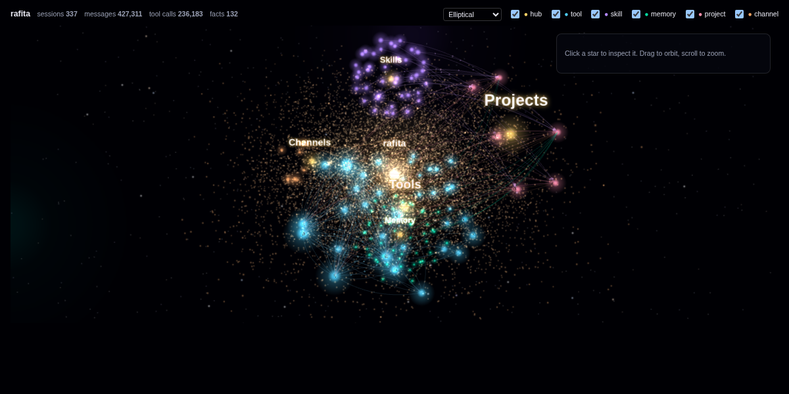

# Agent Galaxy

An interactive 3D galaxy of a [Hermes](https://github.com/NousResearch/hermes-agent) agent: its
tools, skills, memory, projects and channels as glowing stars around the agent's core, with
particles flowing along what the agent actually does — which tool follows which, the tools and
skills each project uses, the channels sessions arrive from.

It runs two ways: as a **Galaxy** tab in the Hermes web dashboard, or as a **static site** you
export and host anywhere.



Live example: <https://agent.kurenn.dev>

## Dashboard tab

```bash
hermes plugins install agent-galaxy --enable          # from the Hermes plugin catalog
hermes plugins install kurenn/agent-galaxy --enable   # or straight from this repository
```

Then restart the dashboard (or the gateway that serves it); the plugin's backend route only
loads at startup. The tab appears after **Analytics**.

Optionally name the core star (it defaults to the profile name, or "Hermes"):

```bash
hermes config set agent_galaxy.name my-agent
```

Hermes notes that `agent_galaxy.name` is not one of its own keys and saves it anyway; the
plugin reads it.

The data comes from `GET /api/plugins/agent-galaxy/graph`, which sits behind the dashboard's
login like every plugin route. It includes memory fact text, so treat it as private.

## Static site

```bash
python3 export.py --hermes-home ~/.hermes --name my-agent --out galaxy-site
python3 -m http.server -d galaxy-site 8000   # preview at http://localhost:8000
```

Upload `galaxy-site/` to any static host. It must be served over HTTP(S) — the page fetches
`graph.json`, which browsers block from `file://`. Re-run the export to refresh it.

**What a public export contains:** tool, skill, project, channel and memory-entity *names*
(entity names capped at 48 characters), and all counts. It leaves out memory fact text and
full project paths. `--private` puts both back; only use it for a page behind your own auth.
Read `graph.json` before publishing it — entity names come from your agent's memory and can
name people or clients. `--min-facts 2` keeps only entities with at least two facts, which
also drops most of the noise; `--hide "name,other"` leaves out stars by name, of any kind
(entities, projects, channels, tools, skills); `--no-memory` leaves memory out entirely.

## What you are looking at

| Star | Size | Source |
|---|---|---|
| core | sessions | the agent |
| tools (cyan) | calls | tool results in `state.db` |
| skills (violet) | loads | `skill_view` calls, top 40 |
| memory (green) | facts | entities in the holographic `memory_store.db` |
| projects (pink) | sessions | session working directories (not `/`, a bare home, or Hermes's own) |
| channels (orange) | sessions | session sources: cli, cron, subagent, api_server… |

Animated links: tool → next tool (top 150 sequences), project → its top 6 tools and skills,
channel → project. Static links: memory entities that share a fact, and entities whose name
mentions a project. Pick a galaxy type (elliptical, spiral, barred spiral, ring, irregular)
from the top bar; the choice is remembered per browser.

## How it works

- `plugin.yaml` + `__init__.py` make it an installable Hermes plugin under the name
  `agent-galaxy`, whatever the repository is called. The agent-side `register()` does nothing.
- `dashboard/galaxy_graph.py` builds the graph. Standard library only; opens every database
  read-only (`mode=ro`) and never writes.
- `dashboard/plugin_api.py` serves it to the dashboard, cached for two minutes.
- `dashboard/dist/index.js` draws it with [3d-force-graph](https://github.com/vasturiano/3d-force-graph)
  1.80.1, loaded from jsDelivr pinned by Subresource Integrity, plus three.js r186's core
  (`dist/three.core.min.js`, vendored, MIT) for the glow, stardust and starfield.
- `export.py` + `standalone/index.html` wrap the same `index.js` in a page that supplies the
  two globals the dashboard normally provides.

Large histories make the first graph build after a restart slow (seconds) while SQLite reads
`state.db` from disk; it is cached afterwards.

## Before you install

- **Reads outside its own data:** `state.db` (sessions and messages) and the holographic
  memory store `memory_store.db` in your Hermes home, read-only; the plugin never writes.
- **Network:** the dashboard tab and the static page load 3d-force-graph 1.80.1 from
  `cdn.jsdelivr.net`, pinned by Subresource Integrity, so the browser refuses any other bytes.
  The static page also loads React 18.3.1 from jsDelivr the same way. The Python side makes no
  network calls.
- **No** agent tools, hooks or middleware, shell commands, background processes, stored
  credentials or telemetry.

## License

MIT — see [LICENSE](LICENSE). `dashboard/dist/three.core.min.js` is three.js (MIT, © three.js
authors), redistributed unmodified with its license header.
